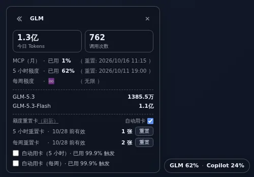
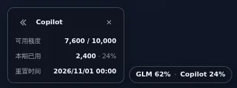
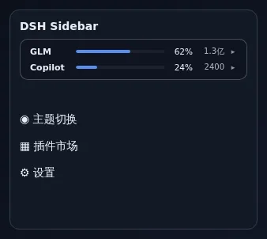

# DSH Quota Watch

[](https://github.com/iasiv5/dsh-quota-watch/releases)
[](https://github.com/iasiv5/dsh-quota-watch/actions/workflows/ci.yml)
[](https://www.npmjs.com/package/@iasiv5/dsh-quota-watch)
[](./LICENSE)

[English summary](#english-summary) · 中文

在 DSH 中查看 **GLM Coding Plan** 与 **GitHub Copilot** 的服务商额度快照。Quota Watch 不读取 DSH 会话 token；凭据由 DSH 宿主解析，浏览器只接收整理后的额度数据。


## 功能

- **悬浮胶囊与详情面板**：胶囊显示 GLM、Copilot 已用百分比；点击查看额度窗口、重置时间及服务商报告的用量统计。胶囊可拖动，位置会记忆并保持在可视区域内。
- **GLM 详情**：显示今日 tokens、调用次数、额度窗口及分模型用量。额度窗口与今日用量是不同的服务商统计口径。
- **Copilot 详情**：显示服务商报告的可用额度、本期已用额度与重置时间；插件不会从已用 credits 推算剩余额度。
- **侧边栏卡片（可选开启，占侧栏 footer 第一槽位）**：由面板底部的显示/隐藏开关控制，默认关闭；悬浮胶囊始终是主要入口。
- **容错与语言适配**：界面跟随 DSH 语言设置。探测失败时保留最后一次成功的快照并标记为过期；缺少服务商凭据时不显示对应额度行。

## 兼容性与前置要求

| 项目 | 要求或声明 |
|---|---|
| DSH | `>=0.1.7-rc.2`（包元数据声明的最低版本） |
| Node.js | `>=20` |
| Cordis | peer dependency `^4.0.2` |
| 客户端平台 | 包元数据声明 `web` |

该插件已分别在 DSH Web 与 Desktop profile 上完成人工适配验证；这项运行时验证不由 CI 自动化覆盖。CI 运行 Node 测试、构建和安全检查，不包含 DSH Web / Desktop 运行时矩阵。

## 安装

### DSH 插件市场

在 DSH 的「插件市场」搜索 **Quota Watch** 或「额度」，从市场安装。dsh-m 对 npm 包使用精确版本并校验 integrity；后续更新也可在市场中管理。

### 命令行（Web / Desktop profile）

```sh
dsh plugin --profile web add @iasiv5/dsh-quota-watch
dsh plugin --profile desktop add @iasiv5/dsh-quota-watch
```

Web 与 Desktop profile 均已实测适配。按 DSH 插件管理器提示完成安装与生效；宿主侧 patch 发生变化时，Web 重启 DSH Web，Desktop 退出并重新打开应用，之后刷新页面加载客户端界面。

## 配置

在 GLM 详情面板的「自动用卡」配置界面，可分别设置两个独立开关：

- **5 小时自动用卡**：默认关闭。
- **每周自动用卡**：默认关闭。

开启某个开关即授权对应窗口自动使用重置卡；阈值与消费风险见下一节。

## 重置卡与自动用卡

> **重置卡是可消耗、不可撤销的订阅权益。** 使用前请确认适用范围、卡种与额度窗口。

仅支持配置为 `zai-coding-cn` 的**国内站个人版**。国际站 `zai` / `zai-coding` 不提供此入口；团队版未验证、不在支持范围内。重置卡列表按卡种显示可用张数与最早到期日；「刷新」只查询卡数，不会消费卡。手动使用前，宿主会重新查询当前卡列表，面板也会先显示二次确认。5 小时卡重置 5 小时窗口；每周卡同时重置每周与 5 小时窗口。



图中的「自动用卡」勾选框只展开设置，不授权消费；下方 5 小时与每周两个开关才是各自独立的授权，截图中均为关闭状态。

自动用卡须特别留意：

- 两个窗口分别授权，默认均关闭；默认触发阈值是**已用 99.9%**（可设为 `50–99.9%`）。若启用时额度已达到阈值，下一次有效探测可能立即消费一张卡。
- 开关与阈值保存在 DSH 宿主侧；关闭浏览器后，宿主仍可按轮询执行已授权的自动用卡。若保存设置损坏或无法读取，自动用卡会安全关闭。
- 只使用本轮成功探测得到的新鲜 GLM 额度；过期快照不会触发消费。消费请求串行执行，每周卡优先；周卡成功后会同时解除 5 小时窗口的自动触发。
- 默认宿主探测间隔为 60 秒；额度可能在两次探测之间耗尽，自动用卡**不保证不断流**。
- 确定失败后至少等待 10 分钟才会重试。若 POST 超时、连接中断或结果无法判定，上游可能已经扣卡；插件会停止该窗口的自动重试。请先核实官方卡数与额度，不要盲目重试。
- 国内站重置卡接口未公开且可能变化。使用前请核对智谱 Coding Plan 的适用工具与服务条款；不接受消耗型操作或未公开接口风险时，请勿使用重置卡功能。

## Copilot 与侧边栏界面





## 数据、隐私与安全

- **额度是快照，不是会话账本**：GLM 的额度窗口、今日 tokens / 调用次数，以及 Copilot 的额度视图都来自服务商报告；网络或上游处理可能造成延迟。
- **Copilot 额度语义**：插件只采用 GitHub 报告的 `remaining` 与 `percent_remaining`；不会用 `credits_used` 推算余额。组织管理的 seat 可能使用共享计费池，个人额度视图不等于组织剩余余额。
- **凭据与存储**：GLM 的 `llm-pi-ai` `apiKeyEnv` 引用和 Copilot OAuth grant 由 DSH 宿主解析并用于 HTTPS 请求。浏览器只接收归一化额度字段；插件不把 key、OAuth grant 或原始服务商响应写入磁盘，也不保存额度历史。自动用卡的开关与阈值是例外：它们保存在前述宿主设置文件中。
- **路由保护**：API 路由只接受 loopback 或已配对浏览器的同源请求，并禁用缓存。
- **公开包检查**：npm 包使用显式 `files` allowlist；CI 的 `npm run security:check` 扫描工作树与由 allowlist 推导的候选打包文件，诊断仅报告路径和规则名，不打印匹配值。
- **服务商限制**：Copilot quota endpoint 和 GLM 重置卡接口均不是稳定的公开契约，字段或行为可能变化；无法确认额度含义时，插件会显示不可用，而不会自行推算。

401/403 等授权错误出现时，请在 DSH 中重新授权相应服务商；若某一行标记为过期，显示值是最近一次成功快照，而非当前实时余额。

## English summary

DSH Quota Watch displays provider-reported quota snapshots for GLM Coding Plan and GitHub Copilot in a floating capsule, detail panel, and optional sidebar card that is hidden by default and toggled from the panel. It does not read DSH session tokens or derive Copilot remaining credits from credits used. The declared requirements are DSH `>=0.1.7-rc.2`, Node.js `>=20`, and Cordis peer `^4.0.2`; the package declares a Web client target. The plugin has been manually verified with both DSH Web and Desktop profiles; CI does not run host-profile integration tests.

Install for a DSH Web or Desktop profile from the DSH plugin marketplace. Both profiles have been manually verified; the CLI install commands are shown above.

**Reset cards are optional, irreversible spending.** They are supported only for domestic `zai-coding-cn` personal plans. Automatic use is separately authorized per window and defaults off. The upstream reset-card APIs are undocumented and may change; an ambiguous timeout may still have consumed a card, so verify the provider state before retrying.

All screenshots contain synthetic example data.